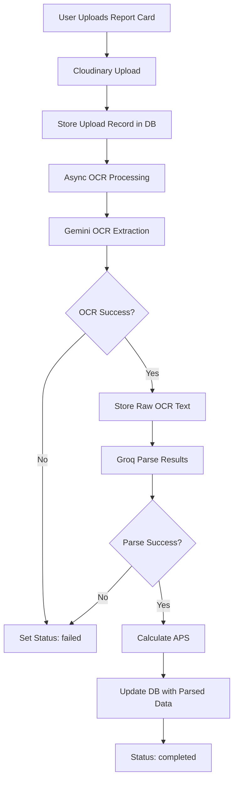
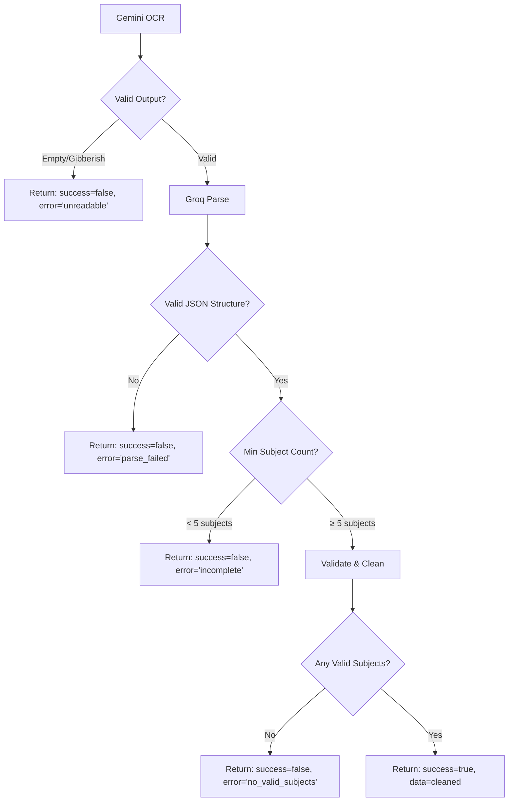

# OCR Error Handling Analysis: Cloudinary → Groq Data Flow

## Current Data Flow Architecture



## Error Handling Assessment

### ✅ What's Working Well

1. **Gemini Service** - [`extractTextFromImage()`](src/services/geminiService.js:6) returns structured error response:
   ```javascript
   return { success: false, error: error.message }
   ```

2. **Groq Service** - [`parseResults()`](src/services/groqService.js:8) has try-catch around:
   - API call to Groq
   - JSON.parse of response
   - Returns `{ success: false, error: error.message }`

3. **ResultsController** - [`processOCR()`](src/controllers/resultsController.js:57) wraps entire flow in try-catch and sets `ocr_status = 'failed'` on error

### ⚠️ Critical Gaps in Error Handling

#### 1. No Validation of Empty/Gibberish OCR Output

**Location:** [`geminiService.js:45-50`](src/services/geminiService.js:45)

**Issue:** If Gemini returns empty text, garbled characters, or "I cannot read this image", the code proceeds to Groq anyway.

**Current behavior:**
```javascript
const response = result.response.text();
return { success: true, rawText: response }  // Always success: true!
```

**Risk:** Groq will attempt to parse nonsense, wasting API calls and potentially returning invalid data.

---

#### 2. No Validation of Groq Response Structure

**Location:** [`groqService.js:46-52`](src/services/groqService.js:46)

**Issue:** After parsing JSON, the code assumes `parsed.subjects` exists and is an array.

**Current behavior:**
```javascript
const parsed = JSON.parse(completion.choices[0].message.content);
return { success: true, data: this.validateAndClean(parsed) }
```

**Risk:** If Groq returns `{ error: "Could not parse" }` or `{"subjects": null}`, the `validateAndClean()` method will fail or return empty data silently.

---

#### 3. Silent Failure in validateAndClean

**Location:** [`groqService.js:63-87`](src/services/groqService.js:63)

**Issue:** Invalid subjects are skipped with `continue`, but no warning is logged. If ALL subjects are invalid, an empty array is returned as "success".

**Current behavior:**
```javascript
for (const subj of data.subjects || []) {
    if (!subj.subject || typeof subj.mark !== 'number') continue;  // Silent skip
    // ...
}
return { subjects: validSubjects, ... }  // Could be empty!
```

**Risk:** User gets "success: true" with zero subjects extracted.

---

#### 4. No Minimum Subject Count Validation

**Location:** [`resultsController.js:80-88`](src/controllers/resultsController.js:80)

**Issue:** NSC report cards should have 6-8 subjects. If Groq returns only 1-2 subjects, this indicates parsing failure, but processing continues.

**Current behavior:**
```javascript
const groqResult = await groqService.parseResults(geminiResult.rawText);
if (!groqResult.success) { throw new Error('Result parsing failed'); }
const apsResult = apsCalculator.calculateAPS(groqResult.data.subjects);  // No min count check
```

---

#### 5. No Retry Logic for Transient API Failures

**Location:** Throughout the flow

**Issue:** If Groq or Gemini API times out temporarily, the entire process fails immediately.

---

#### 6. Limited Error Context for Debugging

**Location:** [`resultsController.js:102-109`](src/controllers/resultsController.js:102)

**Issue:** When processing fails, only the generic error is logged. The raw OCR text that caused the failure is not preserved for debugging.

**Current behavior:**
```javascript
} catch (error) {
    console.error('OCR Processing error:', error);
    await query(`UPDATE result_uploads SET ocr_status = 'failed' WHERE id = $1`, [uploadId]);
}
```

---

## Recommended Improvements

### Priority 1: Critical Fixes

1. **Validate Gemini output before sending to Groq**
   - Check for empty/gibberish text
   - Detect "I cannot read this" type responses
   - Return `success: false` for invalid OCR output

2. **Validate Groq response structure**
   - Ensure `subjects` array exists and has minimum length (e.g., 5 subjects)
   - Verify each subject has required fields
   - Return `success: false` if structure is invalid

3. **Add minimum subject count validation**
   - NSC requires 7 subjects minimum
   - Flag results with < 5 subjects as potential parsing errors

### Priority 2: Robustness Improvements

4. **Add retry logic with exponential backoff**
   - Retry transient API failures (timeouts, rate limits)
   - Maximum 3 retries before failing

5. **Preserve error context for debugging**
   - Store raw OCR text even on failure
   - Log specific error reasons to `ocr_raw_text` or new `error_details` column

6. **Add confidence scoring**
   - Track how "clean" the OCR text appears
   - Flag low-confidence extractions for manual review

### Priority 3: User Experience

7. **Provide actionable error messages**
   - Instead of "OCR failed", return "Image quality too low - please upload a clearer photo"
   - Detect common issues: blurry image, wrong document type, incomplete photo

---

## Proposed Error Handling Flow



---

## Specific Code Changes Needed

### 1. Update [`geminiService.js`](src/services/geminiService.js:6)

```javascript
async extractTextFromImage(base64Image, mimeType = 'image/jpeg') {
    try {
        // ... existing code ...
        
        const response = result.response.text();
        
        // NEW: Validate OCR output quality
        if (!response || response.trim().length < 10) {
            return {
                success: false,
                error: 'OCR returned empty or too-short response',
                rawText: response
            };
        }
        
        // Check for common failure patterns
        const failurePatterns = [
            /cannot read/i,
            /unable to process/i,
            /no text found/i,
            /image quality/i
        ];
        
        for (const pattern of failurePatterns) {
            if (pattern.test(response)) {
                return {
                    success: false,
                    error: 'OCR could not read the image clearly',
                    rawText: response
                };
            }
        }
        
        return { success: true, rawText: response };
        
    } catch (error) {
        // ... existing error handling ...
    }
}
```

### 2. Update [`groqService.js`](src/services/groqService.js:8)

```javascript
async parseResults(rawOcrText) {
    try {
        // ... existing code ...
        
        const parsed = JSON.parse(completion.choices[0].message.content);
        
        // NEW: Validate response structure
        if (!parsed.subjects || !Array.isArray(parsed.subjects)) {
            return {
                success: false,
                error: 'Invalid response structure: missing subjects array'
            };
        }
        
        if (parsed.subjects.length < 5) {
            return {
                success: false,
                error: `Insufficient subjects found: ${parsed.subjects.length}. Minimum 5 required.`
            };
        }
        
        const cleaned = this.validateAndClean(parsed);
        
        // NEW: Verify cleaning produced valid results
        if (!cleaned.subjects || cleaned.subjects.length === 0) {
            return {
                success: false,
                error: 'No valid subjects after cleaning - OCR may be too messy'
            };
        }
        
        return { success: true, data: cleaned };
        
    } catch (error) {
        // ... existing error handling ...
    }
}
```

### 3. Update [`resultsController.js`](src/controllers/resultsController.js:57)

```javascript
async processOCR(uploadId, imageUrl, mimeType) {
    try {
        // ... existing code ...
        
        // Step 1: Gemini OCR
        const geminiResult = await geminiService.extractTextFromImage(base64, mimeType);
        
        if (!geminiResult.success) {
            // NEW: Store error details for debugging
            await query(`
                UPDATE result_uploads 
                SET ocr_raw_text = $1, ocr_error = $2, ocr_status = 'failed'
                WHERE id = $3
            `, [geminiResult.rawText || '', geminiResult.error, uploadId]);
            return;
        }
        
        // ... store raw OCR ...
        
        // Step 2: Groq parsing
        const groqResult = await groqService.parseResults(geminiResult.rawText);
        
        if (!groqResult.success) {
            // NEW: Store detailed error
            await query(`
                UPDATE result_uploads 
                SET ocr_error = $1, ocr_status = 'failed'
                WHERE id = $2
            `, [groqResult.error, uploadId]);
            return;
        }
        
        // ... rest of existing code ...
        
    } catch (error) {
        console.error('OCR Processing error:', error);
        // NEW: Store exception details
        await query(`
            UPDATE result_uploads 
            SET ocr_error = $1, ocr_status = 'failed'
            WHERE id = $2
        `, [error.message, uploadId]);
    }
}
```

---

## Database Schema Changes Needed

Add error tracking column to `result_uploads` table:

```sql
ALTER TABLE result_uploads 
ADD COLUMN ocr_error TEXT,
ADD COLUMN retry_count INTEGER DEFAULT 0;
```

---

## Summary

**Current State:** Basic error handling exists but has significant gaps. Messy OCR text from report cards could result in:
- Silent failures (empty subject arrays marked as "success")
- Wasted API calls on gibberish text
- No debugging information when things go wrong
- Poor user experience with generic error messages

**Recommended Actions:** Implement the Priority 1 fixes to ensure robust parsing validation, then add retry logic and better error context for production readiness.
